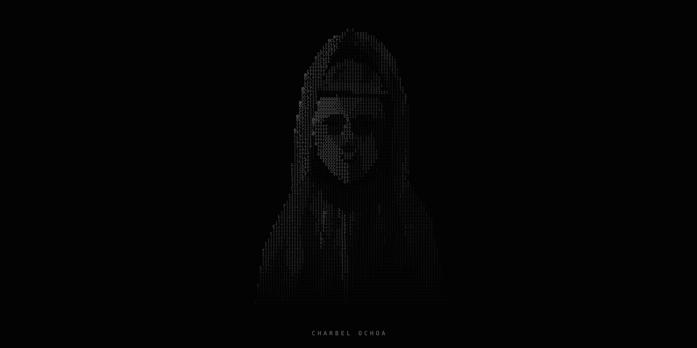

  

  <a href="https://github.com/charbelochoa">GitHub ↗</a>
  &nbsp;&nbsp; / &nbsp;&nbsp;
  <a href="https://github.com/charbelochoa/Node-Panda">Node-Panda</a>
  &nbsp;&nbsp; / &nbsp;&nbsp;
  <a href="https://github.com/charbelochoa/Clients-Model">Clients-Model</a>
  &nbsp;&nbsp; / &nbsp;&nbsp;
  <a href="https://github.com/charbelochoa/Orbit">Orbit</a>

<!-- Original research dossier: docs/RESEARCH.md. Website and blog: docs/DEVELOPMENT.md. -->
