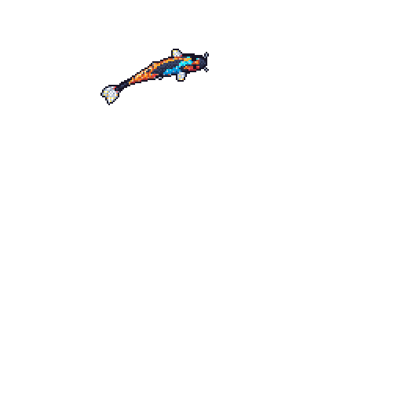
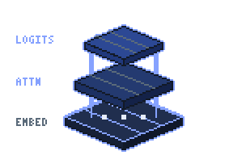
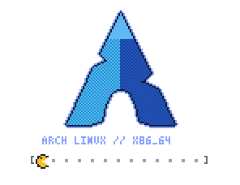

<p align="center">
  <a href="https://github.com/charbelochoa/Orbit">
    
  </a>
</p>

<div align="center">
  <a href="https://charbelochoa.com">
    <picture>
      <source media="(prefers-color-scheme: dark)" srcset="assets/masthead-dark.svg" />
      
    </picture>
  </a>
</div>

<p align="center">
  <a href="https://charbelochoa.com">
    <picture>
      <source media="(prefers-color-scheme: dark)" srcset="assets/pill-portal-dark.svg" />
      
    </picture>
  </a>&nbsp;
  <a href="#02--research-domains--mathematical-foundations">
    <picture>
      <source media="(prefers-color-scheme: dark)" srcset="assets/pill-domains-dark.svg" />
      
    </picture>
  </a>&nbsp;
  <a href="#04--systems-environment-arch-linux--workstation">
    <picture>
      <source media="(prefers-color-scheme: dark)" srcset="assets/pill-arch-dark.svg" />
      
    </picture>
  </a>&nbsp;
  <a href="https://github.com/yalongwastaken/git-koi">
    <picture>
      <source media="(prefers-color-scheme: dark)" srcset="assets/pill-koi-dark.svg" />
      
    </picture>
  </a>
</p>

<br />

<!-- FLOATING TRANSPARENT PIXEL-ART STAGE 01: ISOMETRIC HACKER WORKSTATION + LIVING GIT KOI -->

<a href="https://github.com/yalongwastaken/git-koi">
  
</a>
<br clear="all" />

<p align="center">
  <sub>
    <code>FIG. 00-A</code> Isometric Neural Workstation &nbsp;//&nbsp;
    <code>FIG. 00-B</code> Autonomous Git Koi — redrawn nightly at <code>00:20 UTC</code> from commits, streaks &amp; language distribution
  </sub>
</p>

<br />

<picture>
  <source media="(prefers-color-scheme: dark)" srcset="assets/rule-01-dark.svg" />
  
</picture>

## 01 — Trilingual Research Dossier

> Select a language specification below to toggle each dossier. / Selecciona un idioma para desplegar la presentacion. / 点击下方标签切换语言简介。

<details open>
<summary><kbd>EN</kbd> &nbsp;<b><code>./dossier/charbel_ochoa.en.toml</code></b> — English Specification</summary>
<br />

```toml
[researcher]
name        = "Charbel Ochoa"
affiliation = "Independent AI & Deep Learning Research"
portal      = "https://charbelochoa.com" # in active development
system      = "Arch Linux x86_64"

[domains]
primary     = ["Large Language Models", "Computer Vision", "AI Agents", "Deep Learning", "Machine Learning"]
```

Hello, friend. I am **Charbel Ochoa**, an Artificial Intelligence researcher working across **Large Language Models (LLMs)**, **Computer Vision**, **Autonomous AI Agents**, **Deep Learning**, and **Machine Learning**.

My work bridges mathematical first principles—implementing backpropagation, attention mechanisms, positional encodings, and normalization layers directly from linear algebra in `NumPy` and `C++`—with modern sequence modeling, spatial perception, and memory-augmented agentic systems.

- **Current Pipeline:** Preparing a suite of **Computer Vision** architectures and **Conversational AI / Chatbot** systems for open-source publication.
- **Web Monograph & Hub:** Developing **[charbelochoa.com](https://charbelochoa.com)** *(coming soon)* as a central repository for research notes, interactive benchmarks, and technical essays.

</details>

<details>
<summary><kbd>ES</kbd> &nbsp;<b><code>./dossier/charbel_ochoa.es.toml</code></b> — Presentacion en Espanol</summary>
<br />

```toml
[investigador]
nombre      = "Charbel Ochoa"
enfoque     = "Investigacion en Inteligencia Artificial y Deep Learning"
sitio_web   = "https://charbelochoa.com" # en camino
entorno     = "Arch Linux x86_64"

[lineas_de_investigacion]
principales = ["Modelos de Lenguaje (LLMs)", "Vision por Computadora", "Agentes de IA", "Deep Learning", "Machine Learning"]
```

Hola, amigo. Soy **Charbel Ochoa** y me dedico a la investigacion en **Modelos de Lenguaje (LLMs)**, **Vision por Computadora**, **Agentes de IA**, **Deep Learning** y **Machine Learning**.

Mi enfoque combina la construccion de arquitecturas neuronales desde sus fundamentos matematicos (`NumPy`, algebra lineal y `C++` de alto rendimiento) con el diseno de **Transformers**, sistemas de percepcion visual y agentes autonomos dotados de memoria persistente.

- **Proyectos en Preparacion:** Cuento con diversos sistemas de **vision artificial** y **chatbots / agentes conversacionales** que se integraran publicamente en este repositorio.
- **Portal Personal:** Actualmente desarrollando **[charbelochoa.com](https://charbelochoa.com)** *(en camino)*.

</details>

<details>
<summary><kbd>ZH</kbd> &nbsp;<b><code>./dossier/charbel_ochoa.zh.toml</code></b> — 中文研究简介</summary>
<br />

```toml
[研究者]
姓名     = "Charbel Ochoa"
研究定位 = "人工智能与深度学习基础研究"
个人网站 = "https://charbelochoa.com" # 正在建设中
操作系统 = "Arch Linux x86_64"

[核心领域]
方向     = ["大语言模型 (LLMs)", "计算机视觉 (Computer Vision)", "AI 智能体 (AI Agents)", "深度学习 (Deep Learning)", "机器学习 (Machine Learning)"]
```

你好，朋友。我是 **Charbel Ochoa**，专注于 **大语言模型 (LLMs)**、**计算机视觉 (Computer Vision)**、**AI 智能体 (AI Agents)**、**深度学习 (Deep Learning)** 与 **机器学习 (Machine Learning)** 的研究与工程实现。

我致力于从底层数学原理与线性代数出发（使用 `NumPy` 与高性能 `C++` 从零构建反向传播、自注意力机制、位置编码及归一化层），并将其拓展至现代 **Transformer** 序列建模、视觉感知架构与具备长期记忆机制的自主智能体系统。

- **研发进展：** 多个 **计算机视觉** 系统与 **智能对话机器人 (Chatbots)** 项目已完成核心验证，正在整理并即将陆续开源。
- **个人学术与工程主页：** **[charbelochoa.com](https://charbelochoa.com)** *(即将上线)*。

</details>

<br />

<picture>
  <source media="(prefers-color-scheme: dark)" srcset="assets/rule-02-dark.svg" />
  
</picture>

## 02 — Research Domains & Mathematical Foundations



Research across neural architectures requires treating models not as opaque black boxes, but as differentiable mathematical operators over structured vector spaces. My work concentrates on four interconnected pillars:

1. **Sequence Modeling & Large Language Models:** Scaled dot-product attention, rotary and sinusoidal positional representations, pre-norm residual streams, and autoregressive decoding dynamics.
2. **Spatial & Computer Vision Systems:** Convolutional receptive fields, spatial patch tokenization (`ViT`), object localization, and cross-modal vision-language alignment.
3. **Autonomous Agents & External Memory:** Low-latency graph memory substrates in `C++`, iterative planning cycles (`Observe -> Reason -> Act`), and deterministic tool execution.
4. **First-Principles Deep Learning:** Analytical gradient derivation, numerical stability, layer normalization, and custom training loops built without high-level framework abstractions.

<br clear="all" />

$$
\mathrm{Attention}(Q, K, V) = \mathrm{softmax}\!\left(\frac{QK^{\top}}{\sqrt{d_k}} + M\right)V, \qquad \mathrm{LN}(x) = \gamma \odot \frac{x - \mu}{\sqrt{\sigma^2 + \epsilon}} + \beta
$$

<details>
<summary><kbd>SPEC 02.A</kbd> &nbsp;<b>Mathematical Primitives Under Active Investigation</b></summary>
<br />

| Operator / Formulation | Domain | Analytical Focus |
| :--- | :--- | :--- |
| $\mathcal{L}(\theta) = -\sum_{t=1}^{T} \log p_{\theta}(x_t \mid x_{<t})$ | **LLMs** | Autoregressive cross-entropy optimization, token conditioning & perplexity scaling |
| $z_0 = [x_{\text{cls}}; \, x_p^1 E; \, \dots; \, x_p^N E] + E_{\text{pos}}$ | **Computer Vision** | Linear patch projection ($P \times P$ spatial blocks) into latent transformer dimensions |
| $m_{t+1} = \Phi_{\text{graph}}(m_t, o_t, a_t)$ | **AI Agents** | High-speed `C++` associative "second-brain" state transitions & retrieval |
| $\theta_{k+1} = \theta_k - \eta \, \nabla_{\theta}\mathcal{L}(\theta_k)$ | **Deep Learning** | Exact Jacobian/backpropagation verification from raw matrix calculus |

</details>

<br />

<picture>
  <source media="(prefers-color-scheme: dark)" srcset="assets/rule-03-dark.svg" />
  
</picture>

## 03 — Neural Architecture & Tensor Pipeline

<picture>
  <source media="(prefers-color-scheme: dark)" srcset="assets/schematic-dl-dark.svg" />
  
</picture>

<details>
<summary><kbd>SPEC 03.A</kbd> &nbsp;<b>Architectural Signal Flow &amp; Subsystem Coupling</b></summary>
<br />

- **Stage 01 — Token & Patch Ingestion:** Symbolic sequences and 2D spatial frames are projected into a shared $d_{\text{model}}$ latent manifold equipped with positional structure.
- **Stage 02 — Multi-Head Contextualization:** Parallel attention heads resolve long-range syntactic and spatial dependencies while `LayerNorm` stabilizes activation variance across depth.
- **Stage 03 — Differentiable Optimization:** Parameters are updated under explicit gradient monitoring, validating convergence dynamics from synthetic benchmarks up to real-world datasets.
- **Stage 04 — Agentic Policy & Memory:** Latent representations drive structured tool calls and persistent graph-memory reads/writes (`Node-Panda` / `Orbit`).

</details>

<br />

<picture>
  <source media="(prefers-color-scheme: dark)" srcset="assets/rule-04-dark.svg" />
  
</picture>

## 04 — Systems Environment: Arch Linux & Workstation

<!-- FLOATING TRANSPARENT PIXEL-ART STAGE 02: ARCH LINUX PACMAN SYNC + WAVING LINUX TUX -->
<p align="center">
  
  &nbsp;&nbsp;&nbsp;&nbsp;&nbsp;&nbsp;
  
</p>

<p align="center">
  <sub>
    <code>FIG. 04-A</code> Arch Linux <code>x86_64</code> Rolling Environment (<code>pacman -Syu</code>) &nbsp;//&nbsp;
    <code>FIG. 04-B</code> Linux Kernel Mascot (<code>Tux</code>)
  </sub>
</p>

<br />

<picture>
  <source media="(prefers-color-scheme: dark)" srcset="assets/schematic-training-dark.svg" />
  
</picture>

<details open>
<summary><kbd>SYS.ENV</kbd> &nbsp;<b>Workstation Toolchain &amp; Technical Stack</b></summary>
<br />

```text
OS          :: Arch Linux x86_64 (rolling)
SHELL       :: zsh / POSIX CLI workflow
LANGUAGES   :: Python 3 · C++20 · TypeScript · SQL
ML / DL     :: PyTorch · NumPy (from-scratch kernels) · scikit-learn · pandas · Matplotlib
VISION & AI :: OpenCV · Vision Transformers · Multi-Head Attention · Agent Memory Graphs
DESIGN      :: Technical drafting CSS (readme.css) — Bricolage Grotesque / Hanken Grotesk / JetBrains Mono
```

</details>

<br />

<picture>
  <source media="(prefers-color-scheme: dark)" srcset="assets/rule-05-dark.svg" />
  
</picture>

## 05 — Active Repository Index & Implementations

Every foundational module below is implemented openly to expose the underlying mathematics, memory layout, or systems architecture:

| Index | Repository | Primary Stack | Architectural Scope |
| :--- | :--- | :--- | :--- |
| `05.01` | [`transformer-translator_first_try`](https://github.com/charbelochoa/transformer-translator_first_try) | `Python` | Sequence-to-sequence Transformer encoder-decoder translation pipeline |
| `05.02` | [`attention-practice`](https://github.com/charbelochoa/attention-practice) | `Jupyter` / `Python` | Scaled Dot-Product & Multi-Head Attention weight mechanics and masking |
| `05.03` | [`positional-encoding-practice`](https://github.com/charbelochoa/positional-encoding-practice) | `Jupyter` / `Python` | Sinusoidal & learned positional embedding geometry across sequence lengths |
| `05.04` | [`layer-norm-practice`](https://github.com/charbelochoa/layer-norm-practice) | `Jupyter` / `Python` | Pre-norm / post-norm feature stabilization and affine parameter gradients |
| `05.05` | [`Node-Panda`](https://github.com/charbelochoa/Node-Panda) | `C++` | High-throughput "second-brain" associative memory engine for LLMs and AI Agents |
| `05.06` | [`Orbit`](https://github.com/charbelochoa/Orbit) | `TypeScript` | Early autonomous AI agent runtime and modular task orchestration |
| `05.07` | [`Digit-Classificator`](https://github.com/charbelochoa/Digit-Classificator) | `NumPy` / `Math` | Neural network built strictly from scratch—manual forward pass, backprop & training loop |
| `05.08` | [`Netflix-Neural-Network`](https://github.com/charbelochoa/Netflix-Neural-Network) | `NumPy` / `sklearn` | Custom multi-layer neural estimator built without high-level deep learning wrappers |
| `05.09` | [`Heart-Attack-Model`](https://github.com/charbelochoa/Heart-Attack-Model) | `NumPy` / `pandas` | Clinical risk prediction neural model engineered with raw matrix operations |
| `05.10` | [`Clients-Model`](https://github.com/charbelochoa/Clients-Model) | `Python` / `DL` | Churn & subscription retention forecasting via Machine Learning and Deep Learning |
| `05.11` | [`Trade`](https://github.com/charbelochoa/Trade) | `C++` | Algorithmic trading platform with live MT5 bridge and trained AI execution model |
| `05.12` | [`ExSQL`](https://github.com/charbelochoa/ExSQL) | `TypeScript` | Local server bridge transforming structured spreadsheet workbooks directly into SQL schemas |

<br />

<picture>
  <source media="(prefers-color-scheme: dark)" srcset="assets/rule-06-dark.svg" />
  
</picture>

## 06 — Upcoming Research Pipeline & Web Portal

Several flagship research lines and applied systems are currently undergoing clean packaging, documentation, and benchmark verification prior to release:

| Code | Initiative | Domain | Publication Status |
| :--- | :--- | :--- | :--- |
| `PIPE.CV` | **Artificial Vision Systems** | Real-time spatial perception, object detection & deep visual representation pipelines | `Staging — repository release pending` |
| `PIPE.LM` | **Conversational AI & Chatbots** | Multi-turn dialogue architectures, tool-augmented LLM assistants & persistent context | `Staging — repository release pending` |
| `PIPE.WEB` | **[charbelochoa.com](https://charbelochoa.com)** | Personal research monograph, interactive experiments, publications & project archive | `In active construction — launching soon` |

<details>
<summary><kbd>NOTE 06.A</kbd> &nbsp;<b>Design &amp; Typography Specification (<code>readme.css</code>)</b></summary>
<br />

This repository includes [`readme.css`](readme.css), an editorial stylesheet designed around **technical drafting paper, slate rules, and cobalt ink** (`Bricolage Grotesque`, `Hanken Grotesk`, and `JetBrains Mono` with full `prefers-color-scheme: light dark` support) for rendering `<article class="markdown-body">` across standalone HTML deployments and **[charbelochoa.com](https://charbelochoa.com)**.

</details>

<br />

<picture>
  <source media="(prefers-color-scheme: dark)" srcset="assets/rule-07-dark.svg" />
  
</picture>

## 07 — Autonomous Telemetry: Living Git Koi

<details>
<summary><kbd>CRON 00:20 UTC</kbd> &nbsp;<b>How the Nightly Git Koi Organism Works</b></summary>
<br />

The pixel-art obsidian koi (`koi/koi.gif`) swimming in the upper stage is generated deterministically from this GitHub account's public history via [`yalongwastaken/git-koi`](https://github.com/yalongwastaken/git-koi) and updated nightly by [`.github/workflows/koi.yml`](.github/workflows/koi.yml):

1. **Coat Pigmentation:** Derived proportionally from owned and contributed public repository languages (`Python`, `Jupyter Notebook`, `C++`, `TypeScript`).
2. **Morphological Growth:** Scales across six developmental stages according to cumulative public contribution history.
3. **Behavioral Kinematics:** Selects daily swim trajectories and surface-feeding patterns from the commit cadence and streak of the UTC day that just concluded.

</details>

---

<p align="center">
  <sub>
    <code>CHARBEL OCHOA</code> &nbsp;//&nbsp;
    <code>LLMs · COMPUTER VISION · AI AGENTS · DEEP LEARNING</code> &nbsp;//&nbsp;
    <a href="https://charbelochoa.com">charbelochoa.com</a>
  </sub>
</p>
