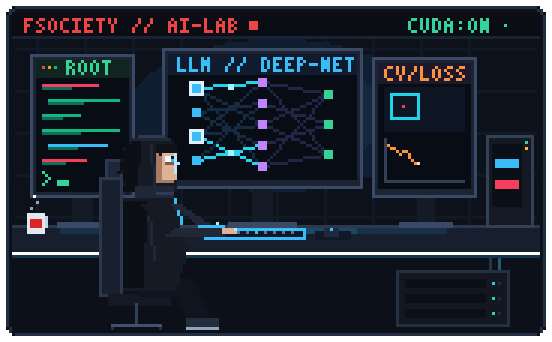
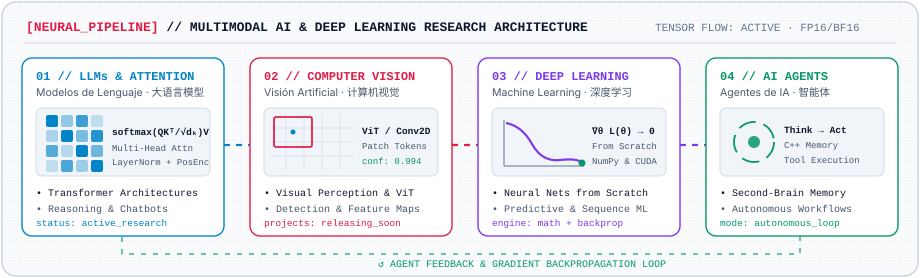

<div align="center">
  <a href="https://charbelochoa.com">
    
  </a>
</div>

<p align="center">
  <a href="https://charbelochoa.com"></a>&nbsp;
  <a href="#-ai--deep-learning-architecture"></a>&nbsp;
  <a href="https://github.com/yalongwastaken/git-koi"></a>
</p>

<!-- SIDE-BY-SIDE LIVING PIXEL-ART STAGE: MR. ROBOT AI WORKSTATION + NIGHTLY GIT KOI -->

<a href="https://github.com/yalongwastaken/git-koi">
  
</a>
<br clear="all" />

<p align="center">
  <sub>
    <code>[LEFT]</code> <b>fsociety // AI Research Rig</b> — pixel workstation running LLMs, Neural Nets &amp; CV &nbsp;·&nbsp;
    <code>[RIGHT]</code> <b>Living Git Koi</b> — evolves every night from my commits, streaks &amp; languages
  </sub>
</p>

---

### 🌐 Interactive Terminal · Presentación · 个人简介

> *Click any language module below to expand or switch terminals / Haz clic en cualquier idioma para desplegar / 点击下方语言切换个人简介：*

<details open>
<summary><kbd>🇺🇸 EN</kbd> &nbsp;<b><code>$ cat ./profile/charbel_en.md</code></b> — <i>English Presentation</i></summary>
<br />

```yaml
name: "Charbel Ochoa"
focus: ["Large Language Models (LLMs)", "Computer Vision", "AI Agents", "Deep Learning", "Machine Learning"]
website: "https://charbelochoa.com (coming soon)"
status: "Researching, training & building intelligent systems"
```

Hello, friend. I'm **Charbel Ochoa**, dedicated to research in **Large Language Models (LLMs)**, **Computer Vision**, **Autonomous AI Agents**, **Deep Learning**, and **Machine Learning**.

- 🧠 **Core Research:** Designing and dissecting neural architectures from first principles (`NumPy` / `C++` / math) up to modern **Transformers**, self-attention mechanisms, visual perception models, and memory-augmented agents.
- 👁️ **Projects Pipeline:** Currently curating several **Computer Vision** systems and **Conversational AI / Chatbot** projects *(featured repositories dropping here soon)*.
- 🌐 **Web Hub:** **[charbelochoa.com](https://charbelochoa.com)** is currently on the way.

</details>

<details>
<summary><kbd>🇲🇽 ES</kbd> &nbsp;<b><code>$ cat ./profile/charbel_es.md</code></b> — <i>Presentación en Español</i></summary>
<br />

```yaml
nombre: "Charbel Ochoa"
investigacion: ["Modelos de Lenguaje (LLMs)", "Visión por Computadora", "Agentes de IA", "Deep Learning", "Machine Learning"]
web: "https://charbelochoa.com (en camino)"
estado: "Investigando, entrenando y construyendo sistemas inteligentes"
```

Hola, amigo. Soy **Charbel Ochoa** y me dedico a la investigación en **Modelos de Lenguaje (LLMs)**, **Visión por Computadora**, **Agentes de IA**, **Deep Learning** y **Machine Learning**.

- 🧠 **Investigación y Desarrollo:** Construyendo y analizando arquitecturas neuronales desde sus fundamentos matemáticos (`NumPy` / `C++`) hasta **Transformers**, mecanismos de atención, visión artificial y sistemas de agentes autónomos con memoria.
- 👁️ **Proyectos en Camino:** Tengo diversos proyectos de **visión artificial** y **chatbots inteligentes** que iremos publicando aquí próximamente.
- 🌐 **Sitio Web:** **[charbelochoa.com](https://charbelochoa.com)** *(en camino — muy pronto en línea)*.

</details>

<details>
<summary><kbd>🇨🇳 ZH</kbd> &nbsp;<b><code>$ cat ./profile/charbel_zh.md</code></b> — <i>中文个人简介</i></summary>
<br />

```yaml
姓名: "Charbel Ochoa"
研究方向: ["大语言模型 (LLMs)", "计算机视觉 (Computer Vision)", "AI 智能体 (AI Agents)", "深度学习 (Deep Learning)", "机器学习 (Machine Learning)"]
个人网站: "https://charbelochoa.com (即将上线)"
当前状态: "专注于前沿人工智能与深度学习架构研究"
```

你好，朋友。我是 **Charbel Ochoa**，专注于 **大语言模型 (LLMs)**、**计算机视觉 (Computer Vision)**、**AI 智能体 (AI Agents)**、**深度学习 (Deep Learning)** 与 **机器学习 (Machine Learning)** 的研究与探索。

- 🧠 **核心研究：** 从底层数学与从零实现的神经网络 (`NumPy` / `C++`) 出发，深入研究现代 **Transformer** 架构、自注意力机制 (Self-Attention)、视觉感知系统以及具备外部记忆的自主智能体。
- 👁️ **项目动态：** 已研发多个 **计算机视觉** 与 **智能对话机器人 (Chatbots)** 项目 *(正在整理中，即将陆续发布)*。
- 🌐 **个人主页：** **[charbelochoa.com](https://charbelochoa.com)** *(正在建设中，即将上线)*。

</details>

---

### 🧠 AI & Deep Learning Architecture

<picture>
  <source media="(prefers-color-scheme: dark)" srcset="assets/neural-lab-dark.svg" />
  
</picture>

---

### 🗂️ Interactive Lab Modules & Vault

<details>
<summary><kbd>🧪 LAB 01</kbd> &nbsp;<b>Foundational AI, Transformer Primitives &amp; Agent Systems</b> <i>(Click to inspect)</i></summary>
<br />

| Domain | Repository / Module | Focus |
| :--- | :--- | :--- |
| **LLMs & Transformers** | [`transformer-translator_first_try`](https://github.com/charbelochoa/transformer-translator_first_try) · [`attention-practice`](https://github.com/charbelochoa/attention-practice) · [`positional-encoding-practice`](https://github.com/charbelochoa/positional-encoding-practice) · [`layer-norm-practice`](https://github.com/charbelochoa/layer-norm-practice) | Sequence-to-sequence Transformer blocks, Scaled Dot-Product Attention, Positional Encodings & Layer Normalization |
| **AI Agents & Memory** | [`Node-Panda`](https://github.com/charbelochoa/Node-Panda) · [`Orbit`](https://github.com/charbelochoa/Orbit) | High-speed `C++` "second brain" memory graph for LLMs/Agents & early autonomous agent architecture |
| **Deep Learning from Scratch** | [`Digit-Classificator`](https://github.com/charbelochoa/Digit-Classificator) · [`Netflix-Neural-Network`](https://github.com/charbelochoa/Netflix-Neural-Network) · [`Heart-Attack-Model`](https://github.com/charbelochoa/Heart-Attack-Model) | Forward/backward propagation, custom training loops, and predictive neural networks built from pure math & `NumPy` |

</details>

<details>
<summary><kbd>👁️ LAB 02</kbd> &nbsp;<b>Upcoming Vault: Computer Vision, Chatbots &amp; Web Portal</b> <i>(Click to inspect)</i></summary>
<br />

| Initiative | Category | Status |
| :--- | :--- | :--- |
| **Artificial Vision Suite** | Computer Vision · Spatial Deep Learning · Real-Time Perception | `⏳ Staging for release / Próximamente / 即将发布` |
| **Conversational AI & Chatbots** | LLM Dialogue Agents · Tool-Augmented Assistants · Multi-Turn Memory | `⏳ Staging for release / Próximamente / 即将发布` |
| **[charbelochoa.com](https://charbelochoa.com)** | Personal Research Website, Papers, Notes & Interactive Demos | `🚧 Building now / En camino / 建设中` |

</details>

<details>
<summary><kbd>🐟 SYS_KOI</kbd> &nbsp;<b>How the Living Git Koi Works</b> <i>(Click to inspect)</i></summary>
<br />

The pixel-art obsidian koi swimming at the top of this README is powered by [`git-koi`](https://github.com/yalongwastaken/git-koi) and redrawn automatically every night at `00:20 UTC` via GitHub Actions:

- **Obsidian Coat & Markings:** Painted dynamically from my repository languages (`Python` cyan-blue, `Jupyter` orange, `C++` crimson, `TypeScript` azure).
- **Growth & Fin Span:** Evolves organically with cumulative public contributions.
- **Daily Swim Behavior:** Reflects the rhythm and streak of the day that just ended.

</details>

<p align="center">
  <sub>
    <code>root@fsociety:~/charbelochoa#</code> &nbsp;<b>Hello, friend.</b> · <a href="https://charbelochoa.com">charbelochoa.com</a>
  </sub>
</p>
