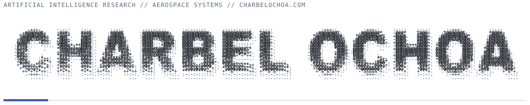
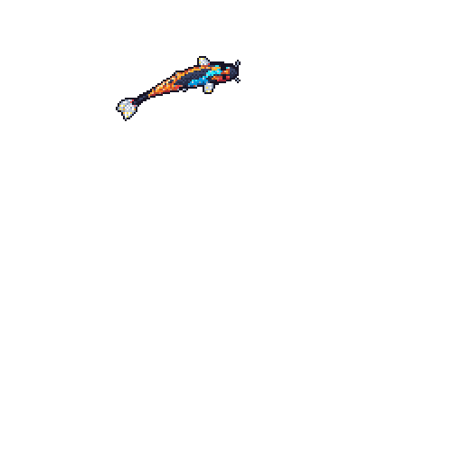
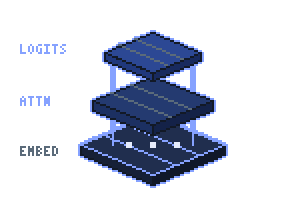
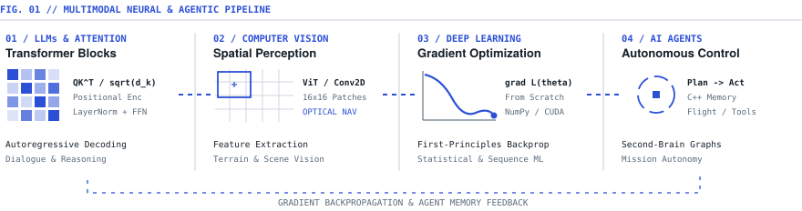
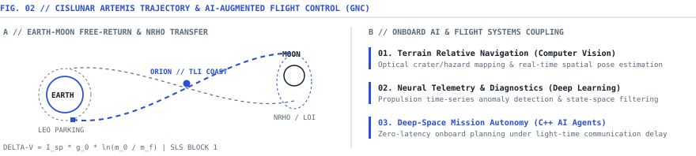
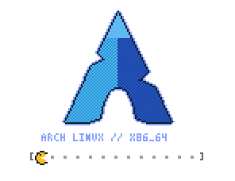
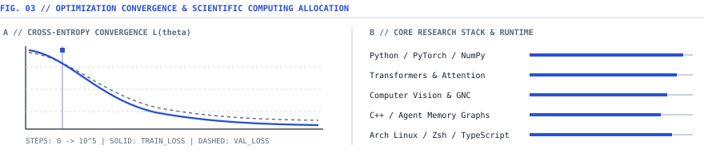

<!-- 

  

  -->

  <a href="https://charbelochoa.com">
    <picture>
      <source media="(prefers-color-scheme: dark)" srcset="../assets/ascii-halftone-dark.svg" />
      
    </picture>
  </a>

  <b>Research in Large Language Models, Computer Vision, Autonomous AI Agents, Deep Learning &amp; Machine Learning — Prospective Aerospace Engineering</b> 
  EN Artificial Intelligence &amp; Aerospace Research &nbsp;//&nbsp; ES Investigacion en IA e Ingenieria Aeroespacial &nbsp;//&nbsp; ZH 人工智能研究与航空航天工程

  <a href="https://charbelochoa.com"><b>charbelochoa.com</b></a>
  &nbsp;&nbsp;/&nbsp;&nbsp;
  <a href="#01--executive-profile--trilingual-dossier">Executive Dossier (EN · ES · ZH)</a>
  &nbsp;&nbsp;/&nbsp;&nbsp;
  <a href="#02--research-domains--mathematical-formulations">Neural Foundations</a>
  &nbsp;&nbsp;/&nbsp;&nbsp;
  <a href="#04--aerospace-engineering--autonomous-flight-systems">Aerospace Systems</a>
  &nbsp;&nbsp;/&nbsp;&nbsp;
  <a href="#05--systems-environment-arch-linux--compute-stack">Compute Environment</a>

 

<!-- FLOATING TRANSPARENT PIXEL-ART STAGE 01: ISOMETRIC NEURAL WORKSTATION + LIVING GIT KOI -->

 

  
    <b>FIG. 00-A</b> Isometric Neural Research Workstation &nbsp;//&nbsp;
    <b>FIG. 00-B</b> Autonomous Activity Organism (<a href="https://github.com/yalongwastaken/git-koi">git-koi</a>) — synchronized nightly at 00:20 UTC
  

 

<picture>
  <source media="(prefers-color-scheme: dark)" srcset="../assets/divider-01-dark.svg" />
  
</picture>

## 01 — Executive Profile & Trilingual Dossier

<b>EN // English Executive Profile</b>

 

**Charbel Ochoa** conducts research and systems engineering across **Large Language Models (LLMs)**, **Computer Vision**, **Autonomous AI Agents**, **Deep Learning**, and **Machine Learning**, alongside a planned academic specialization in **Aerospace Engineering**.

His methodology centers on mathematical and computational rigor from first principles—implementing backpropagation kernels, scaled dot-product self-attention, positional representations, and layer normalization directly from linear algebra in NumPy and C++, and scaling those primitives into modern Transformer architectures, spatial perception pipelines, and low-latency associative memory substrates for autonomous agents.

- **Aerospace & Autonomous Flight Trajectory:** Pursuing formal training in **Aerospace Engineering** to unify onboard **Computer Vision**, **Deep Learning**, and **Autonomous Agents** with spacecraft guidance, navigation, and control (GNC).
- **Forthcoming Systems:** Preparing multiple **Computer Vision** architectures and **Conversational AI** systems for structured open-source publication.
- **Research Monograph:** Developing **[charbelochoa.com](https://charbelochoa.com)** *(launching soon)* as a dedicated publication hub for technical papers, benchmarks, and interactive demonstrations.

<b>ES // Perfil Ejecutivo en Espanol</b>

 

**Charbel Ochoa** desarrolla investigacion e ingenieria de sistemas en **Modelos de Lenguaje de Gran Escala (LLMs)**, **Vision por Computadora**, **Agentes Autonomos de Inteligencia Artificial**, **Deep Learning** y **Machine Learning**, con proyeccion de formacion academica en **Ingenieria Aeroespacial**.

Su metodologia parte del rigor matematico y computacional desde primeros principios: construyendo propagacion hacia atras, mecanismos de autoatencion, codificaciones posicionales y operadores de normalizacion directamente mediante algebra matricial en NumPy y C++, extendiendo dichos fundamentos hacia arquitecturas **Transformer**, sistemas de percepcion espacial y motores de memoria asociativa de baja latencia.

- **Proyeccion en Ingenieria Aeroespacial:** Orientado a converger la **Vision Artificial**, el **Aprendizaje Profundo** y los **Agentes Autonomos** con la mecanica orbital, navegacion optica relativa al terreno y sistemas de guiado, navegacion y control (GNC) aeroespacial.
- **Sistemas en Preparacion:** Diversos desarrollos en **vision por computadora** y **arquitecturas conversacionales (chatbots)** se encuentran en fase de documentacion para su publicacion abierta.
- **Portal de Investigacion:** **[charbelochoa.com](https://charbelochoa.com)** *(en desarrollo)* reunira ensayos tecnicos, resultados experimentales y demostraciones interactivas.

<b>ZH // 中文学术与工程简介</b>

 

**Charbel Ochoa** 致力于 **大语言模型 (LLMs)**、**计算机视觉 (Computer Vision)**、**自主 AI 智能体 (Autonomous AI Agents)**、**深度学习 (Deep Learning)** 与 **机器学习 (Machine Learning)** 的理论研究与系统工程实践，并规划深入攻读 **航空航天工程 (Aerospace Engineering)**。

其研究方法注重底层数学与第一性原理：基于线性代数与矩阵微积分，使用 NumPy 与高性能 C++ 从零构建反向传播算子、缩放点积注意力机制、位置编码及层归一化模块，并进一步拓展至现代 **Transformer** 序列架构、空间视觉感知系统以及面向智能体的低延迟外部图记忆引擎。

- **航空航天与自主飞行交叉方向：** 计划将 **计算机视觉**（地形相对光学导航）、**深度学习** 与 **星载自主智能体** 深度融合于航天器制导、导航与控制系统 (GNC) 及深空探测任务。
- **待发布成果：** 多项 **计算机视觉** 系统与 **对话式人工智能 (Conversational AI / Chatbots)** 架构已完成研发验证，正处于开源整理阶段。
- **个人研究门户：** **[charbelochoa.com](https://charbelochoa.com)** *(建设中，即将上线)* 将系统收录技术专论、实验基准与研究笔记。

 

<picture>
  <source media="(prefers-color-scheme: dark)" srcset="../assets/divider-02-dark.svg" />
  
</picture>

## 02 — Research Domains & Mathematical Formulations

Rigorous model architecture treats neural networks as structured compositions of differentiable operators over high-dimensional vector spaces. Active investigation spans four primary pillars:

1. **Autoregressive Sequence Modeling (LLMs):** Multi-head self-attention geometry, causal masking, positional representations, and residual variance preservation across deep Transformer stacks.
2. **Computer Vision & Spatial Representation:** Convolutional feature hierarchies, spatial patch tokenization (ViT), real-time region localization, and optical state estimation.
3. **Autonomous Agentic Architectures:** Associative memory graphs engineered in C++, closed-loop cognitive policies (*Observe -> Estimate -> Plan -> Act*), and deterministic tool execution.
4. **First-Principles Optimization:** Explicit Jacobian derivation, numerical conditioning, and custom training dynamics verified independently of high-level framework abstractions.

 

$$
\mathrm{Attention}(Q, K, V) = \mathrm{softmax}\!\left(\frac{QK^{\top}}{\sqrt{d_k}} + M\right)V, \qquad \mathrm{LN}(x) = \gamma \odot \frac{x - \mu}{\sqrt{\sigma^2 + \epsilon}} + \beta
$$

<b>SPEC 02.A // Core Mathematical Operators &amp; Analytical Scope</b>

 

| Formulation | Research Domain | Analytical Objective |
| :--- | :--- | :--- |
| $\mathcal{L}(\theta) = -\sum_{t=1}^{T} \log p_{\theta}(x_t \mid x_{<t})$ | **Large Language Models** | Autoregressive cross-entropy minimization, context conditioning & perplexity scaling |
| $z_0 = [x_{\text{cls}}; \, x_p^1 E; \, \dots; \, x_p^N E] + E_{\text{pos}}$ | **Computer Vision** | Linear projection of $P \times P$ spatial image patches into Transformer latent spaces |
| $m_{t+1} = \Phi_{\text{graph}}(m_t, o_t, a_t)$ | **Autonomous Agents** | Sub-millisecond C++ associative memory state transitions and context retrieval |
| $\theta_{k+1} = \theta_k - \eta \, \nabla_{\theta}\mathcal{L}(\theta_k)$ | **Deep Learning** | Exact gradient verification and loss-landscape conditioning from raw matrix calculus |

 

<picture>
  <source media="(prefers-color-scheme: dark)" srcset="../assets/divider-03-dark.svg" />
  
</picture>

## 03 — Multimodal Neural & Agentic Architecture

<picture>
  <source media="(prefers-color-scheme: dark)" srcset="../assets/diagram-neural-dark.svg" />
  
</picture>

<b>SPEC 03.A // Architectural Signal Propagation &amp; Subsystem Coupling</b>

 

- **Subsystem 01 — Symbolic & Spatial Ingestion:** Discrete token sequences and 2D optical frames map into a unified $d_{\text{model}}$ embedding manifold preserving temporal and spatial topology.
- **Subsystem 02 — Contextual Attention Synthesis:** Parallel attention heads resolve long-horizon dependencies while pre-layer normalization prevents gradient pathology across depth.
- **Subsystem 03 — Empirical Optimization:** Parameter updates proceed under tracked training and validation trajectories, ensuring generalization across synthetic and applied regimes.
- **Subsystem 04 — Closed-Loop Agency:** Latent state representations interface directly with external C++ memory graphs (*Node-Panda*) and modular execution runtimes (*Orbit*).

 

<picture>
  <source media="(prefers-color-scheme: dark)" srcset="../assets/divider-04-dark.svg" />
  
</picture>

## 04 — Aerospace Engineering & Autonomous Flight Systems

<!-- FLOATING TRANSPARENT PIXEL-ART STAGE 02: NASA ARTEMIS SLS ROCKET + NASA INSIGNIA -->

  
  &nbsp;&nbsp;&nbsp;&nbsp;&nbsp;&nbsp;&nbsp;&nbsp;&nbsp;&nbsp;
  

  
    <b>FIG. 04-A</b> Space Launch System (SLS Block 1 // Artemis) Ascent Profile &nbsp;//&nbsp;
    <b>FIG. 04-B</b> NASA Insignia &amp; Orbital Vector Telemetry
  

 

Modern aerospace vehicles increasingly rely on onboard computational intelligence where deep-space light-time latency precludes real-time ground intervention. My prospective specialization in **Aerospace Engineering** is driven by the mathematical convergence between **deep neural estimation** and **autonomous flight mechanics**:

$$
\Delta v = I_{\mathrm{sp}} g_0 \ln\!\left(\frac{m_0}{m_f}\right), \qquad \hat{x}_{k \mid k} = \hat{x}_{k \mid k-1} + K_k\!\left(z_k - h(\hat{x}_{k \mid k-1})\right)
$$

<picture>
  <source media="(prefers-color-scheme: dark)" srcset="../assets/diagram-aerospace-dark.svg" />
  
</picture>

<b>SPEC 04.A // Research Intersections: Artificial Intelligence x Aerospace Engineering</b>

 

| Flight Discipline | AI / Deep Learning Coupling | Engineering Application |
| :--- | :--- | :--- |
| **Terrain Relative Navigation (TRN)** | Computer Vision & Spatial Feature Matching | Autonomous lunar and planetary descent hazard detection and optical pose estimation |
| **Guidance, Navigation & Control (GNC)** | Reinforcement Learning & Differentiable Control | Fuel-optimal $\Delta v$ trajectory correction and attitude stabilization |
| **Propulsion & Structural Health** | Sequence Models & Deep Anomaly Detection | Real-time telemetry diagnostics across cryogenic stages and turbomachinery |
| **Deep-Space Mission Autonomy** | High-Speed C++ Autonomous AI Agents | Onboard fault recovery, mission scheduling, and execution beyond Earth orbit |

 

<picture>
  <source media="(prefers-color-scheme: dark)" srcset="../assets/divider-05-dark.svg" />
  
</picture>

## 05 — Systems Environment: Arch Linux & Compute Stack

<!-- FLOATING TRANSPARENT PIXEL-ART STAGE 03: ARCH LINUX PACMAN SYNC + WAVING LINUX TUX -->

  
  &nbsp;&nbsp;&nbsp;&nbsp;&nbsp;&nbsp;&nbsp;&nbsp;
  

  
    <b>FIG. 05-A</b> Arch Linux x86_64 Rolling Research Environment &nbsp;//&nbsp;
    <b>FIG. 05-B</b> Linux Kernel Mascot (Tux)
  

 

<picture>
  <source media="(prefers-color-scheme: dark)" srcset="../assets/diagram-compute-dark.svg" />
  
</picture>

<b>SYS.ENV // Workstation Architecture &amp; Scientific Computing Toolchain</b>

 

- **Operating System:** Arch Linux & Kali Linux x86_64 with zsh and POSIX command-line workflow
- **Core Languages:** Python 3, C++20, TypeScript, SQL
- **Scientific & Deep Learning Stack:** PyTorch, NumPy (first-principles tensor kernels), scikit-learn, pandas, Matplotlib
- **Vision & Agentic Systems:** OpenCV, Vision Transformers, Multi-Head Attention, Associative C++ Memory Graphs
- **Typography & Editorial System:** Technical drafting stylesheet ([readme.css](../readme.css)) — Bricolage Grotesque, Hanken Grotesk, JetBrains Mono

 

<picture>
  <source media="(prefers-color-scheme: dark)" srcset="../assets/divider-06-dark.svg" />
  
</picture>

## 06 — Active Repository Index & First-Principles Kernels

Selected public repositories illustrating foundational neural components, systems engineering, and applied machine learning:

| Ref | Repository | Primary Stack | Technical Scope |
| :--- | :--- | :--- | :--- |
| 06.01 | [transformer-translator_first_try](https://github.com/charbelochoa/transformer-translator_first_try) | Python | Sequence-to-sequence Transformer encoder-decoder neural translation architecture |
| 06.02 | [attention-practice](https://github.com/charbelochoa/attention-practice) | Jupyter / Python | Scaled Dot-Product and Multi-Head Attention weight matrices and causal masking |
| 06.03 | [positional-encoding-practice](https://github.com/charbelochoa/positional-encoding-practice) | Jupyter / Python | Sinusoidal and learned positional embedding geometry across variable context lengths |
| 06.04 | [layer-norm-practice](https://github.com/charbelochoa/layer-norm-practice) | Jupyter / Python | Pre-norm and post-norm activation variance stabilization and affine gradient flow |
| 06.05 | [Node-Panda](https://github.com/charbelochoa/Node-Panda) | C++ | High-throughput associative "second-brain" memory substrate for LLMs and autonomous agents |
| 06.06 | [Orbit](https://github.com/charbelochoa/Orbit) | TypeScript | Foundational autonomous AI agent architecture and modular execution runtime |
| 06.07 | [Digit-Classificator](https://github.com/charbelochoa/Digit-Classificator) | NumPy / Math | Multi-layer neural network built strictly from first principles with manual backpropagation |
| 06.08 | [Netflix-Neural-Network](https://github.com/charbelochoa/Netflix-Neural-Network) | NumPy / sklearn | Custom neural estimator engineered directly from matrix operations without high-level frameworks |
| 06.09 | [Heart-Attack-Model](https://github.com/charbelochoa/Heart-Attack-Model) | NumPy / pandas | Clinical risk classification neural network constructed with explicit numerical pipelines |
| 06.10 | [Clients-Model](https://github.com/charbelochoa/Clients-Model) | Python / DL | Subscription retention and churn probability modeling via Machine Learning and Deep Learning |
| 06.11 | [Trade](https://github.com/charbelochoa/Trade) | C++ | Low-latency algorithmic execution platform with live MT5 connectivity and trained AI policy |
| 06.12 | [ExSQL](https://github.com/charbelochoa/ExSQL) | TypeScript | Local server bridge compiling structured spreadsheet workbooks into relational SQL schemas |

 

<picture>
  <source media="(prefers-color-scheme: dark)" srcset="../assets/divider-07-dark.svg" />
  
</picture>

## 07 — Upcoming Research Pipeline & Web Monograph

Active research developments undergoing documentation, benchmarking, and packaging for public release:

| Code | Initiative | Technical Domain | Status |
| :--- | :--- | :--- | :--- |
| PIPE.CV | **Computer Vision Systems** | Spatial perception, real-time object localization & deep visual representation pipelines | Documentation & packaging in progress |
| PIPE.LM | **Conversational AI Architectures** | Context-persistent dialogue agents, tool-augmented LLMs & structured memory retrieval | Documentation & packaging in progress |
| PIPE.WEB | **[charbelochoa.com](https://charbelochoa.com)** | Central research portal, technical monographs, benchmarks & interactive demonstrations | Active engineering — launching soon |

 

<picture>
  <source media="(prefers-color-scheme: dark)" srcset="../assets/divider-08-dark.svg" />
  
</picture>

## 08 — Autonomous Telemetry: Nightly Git Koi

<b>CRON 00:20 UTC // Deterministic Activity Visualization Specification</b>

 

The obsidian pixel-art koi ([koi/koi.gif](../koi/koi.gif)) displayed in the upper workstation stage is synthesized deterministically from public GitHub telemetry via [yalongwastaken/git-koi](https://github.com/yalongwastaken/git-koi) and maintained nightly by [.github/workflows/koi.yml](../.github/workflows/koi.yml):

1. **Chromatophore Distribution:** Computed proportionally from public repository language shares (Python, Jupyter Notebook, C++, TypeScript).
2. **Ontogenetic Stage:** Scales across six morphological growth tiers as cumulative public contributions advance.
3. **Hydrodynamic Behavior:** Selects daily swimming kinematics according to the contribution cadence and streak recorded during the preceding UTC day.

---

  
    <b>CHARBEL OCHOA</b> &nbsp;//&nbsp;
    ARTIFICIAL INTELLIGENCE RESEARCH &amp; AEROSPACE SYSTEMS &nbsp;//&nbsp;
    <a href="https://charbelochoa.com">charbelochoa.com</a>
  

